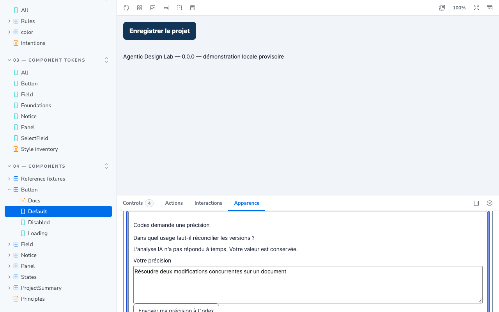
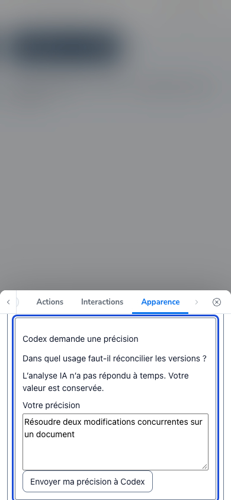

# DS-EDIT-23 — Retour visible et réponse aux précisions Codex

31 octobre 2026 — cible application. **En revue : qualification technique acquise, acceptation humaine différée.** Correction du parcours de recette après le [bilan initial](ds-edit-23-explicit-style-intent.md). Base `d855b3296b491b7527edbbc6ff328eb5984186aa`, branche locale `codex/fix-intent-clarification`. Le [manifeste des neuf sources affectées](ds-edit-23/clarification-source.json) identifie code, tests et guide ; les captures ci-dessous sont issues des parcours synthétiques qualifiés.

## Défaut observé et correction

L’utilisateur signalait l’absence de retour après « Interpréter avec Codex ». Dans la recette 54123, Codex avait effectivement posé une question ; elle était rendue comme un paragraphe ordinaire, sans champ de réponse. L’enregistrement restait correctement verrouillé, mais la suite du parcours était difficile à découvrir.

Le panneau distingue désormais la demande de précision, son champ de réponse, l’attente, l’erreur et la proposition. Le bouton affiche l’analyse en cours. La question et la proposition reçoivent le focus, avec un contour visible. En cas d’échec, l’erreur reste dans le bloc de question et la réponse saisie est conservée. La description initiale et cinq échanges maximum sont transmis comme données à Codex. Modifier la description réinitialise ce contexte ; les réponses tardives sont rejetées. L’application d’une proposition reste explicite, puis le brouillon peut être enregistré selon ses contrôles habituels, dont le contraste.

Le protocole d’interprétation v1 accepte le champ optionnel borné `clarifications`, vide par défaut pour les appels antérieurs. Aucun changement au modèle, aux autorités, au nommage, au writer ou aux comptes. La limite globale d’entrée du processus Codex reste 32 Kio : un contexte trop volumineux peut être refusé avant inférence, avec conservation du texte.

## Vérifications exécutées

Copies isolées ignorées sous `.local/ds-edit-23/clarification-check` et `clarification-final`, runtime local existant Node 24.22.0, sans installation ni nouvel appel fournisseur.

| Commande | Résultat et portée |
| --- | --- |
| `npm test` | **120 réussis**, 17 fichiers. Clarification distincte, réponse obligatoire, reprise après échec sans duplication d’échange, application explicite, cinq réponses maximum et remise à zéro, réponse périmée ignorée, erreur d’empreinte visible. Le premier lancement sous sandbox avait échoué sur l’ouverture d’un port dans le test de configuration locale ; relance avec ports locaux autorisés entièrement conforme. |
| `npm run test:design-agent` | **13 réussis**. Description et précisions réellement transmises au faux transport ; champs inattendus, réponses trop longues et six échanges refusés avant inférence. Fraîcheur, gardes HTTP, confinement et isolation des comptes conservés. |
| `npm run test:design-editor:dev -- assisted.spec.ts` | **6 réussis** sur ordinateur/mobile, version finale. Attente visible et bouton bloqué, question, saisie au clavier, erreur simulée, saisie conservée, nouvel envoi, proposition, sauvegarde désactivée avant application puis activée. Choix local/partagé et retour au geste également contrôlés. |
| `npm run test:design-editor -- assisted.spec.ts` | **4 réussis, 2 exclus** : build Storybook statique final et choix de portée ; interprétation exclue explicitement car le service IA n’existe pas dans cette distribution. |
| `npm run typecheck`, `npm run lint`, `npm run format:check` | Conformes sur la version finale. |
| `npm run test:design-system:docs` | **5 réussis** ; génération, contenu et refus d’injection documentaire conservés. |
| Comparaison de livraison | Les neuf empreintes correspondent au dépôt, à la copie finale testée et à la recette corrigée. Modèle et catalogue enregistrés identiques entre anciennes et nouvelles racines, 188 identités de composants. Aucun état privé copié. |

Le scénario navigateur simule les réponses de Codex et l’erreur réseau ; il vérifie le parcours jusqu’à l’activation d’Enregistrer, sans sauvegarder dans la recette humaine. Le vrai premier retour Codex a été observé dans l’ancien panneau. Un nouvel aller-retour authentifié avec précision, sa sauvegarde et l’acceptation visuelle par le designer restent à éprouver humainement. Les preuves de persistance et récupération du chantier initial restent datées ; ces suites n’ont pas été répétées car le writer et les opérations ne changent pas.

## Revues de la correction

Modes **séquentiels, même agent, non indépendants**, procédures du catalogue applicatif à la base citée.

- **Design Reviewer / `review-design` : satisfaisant avec réserve d’acceptation humaine.** Réponse visible et action explicite, focus et clavier, texte conservé ; captures ordinateur 1280×800 et mobile 390×844 relues. La première relecture avait repéré l’erreur sous le bloc ; retour au Builder, placement dans le bloc puis retest des deux formats. Aucune référence Figma fournie, fidélité graphique indéterminée. Les petites dimensions du panneau Storybook imposent toujours un défilement.
- **Technical Reviewer / `technical-review` : satisfaisant.** Flux UI → session → service → proposition parcouru ; validation avant modèle, contexte borné, absence de doublon après réessai, fraîcheur vérifiée après les opérations asynchrones, application et sauvegarde distinctes. Contrôles proportionnés conformes, aucune migration requise.
- **Security Reviewer / `security-review` : satisfaisant dans le périmètre local.** Question et réponse restent des données non fiables, rendues par React sans HTML brut ; schéma strict et limites avant inférence. Prompt, outils désactivés, plafond de requêtes, capacité, Host/Origin et writer fermé conservés. Aucun compte, secret, journal privé, nouvelle dépendance ou permission persistante transféré. Pas de scan externe ni de certification de sécurité.

## Recette et reprise

Recette corrigée : [Bouton désactivé · Apparence](http://127.0.0.1:54124/?path=/story/components-button--disabled&addonPanel=adl/design-editor/panel), racine locale ignorée `recipe-clarification`. La recette 54123, sa connexion et son brouillon restent dans leur installation d’origine ; aucune modification de ses sources, de son service ni de son onglet. Les valeurs déjà enregistrées et le catalogue sont repris sous verrou de lecture, sans reçus ni données privées. La nouvelle recette nécessite sa propre connexion Codex et ne transporte pas le brouillon non enregistré.

Après la dernière mise à jour de code de la nouvelle recette, le contrôle d’immuabilité a normalement refusé son ancien service ; seul ce nouveau service sans brouillon a été redémarré, sans retrait de protection. Le contrôle de chargement final est consigné dans le bilan du chantier.

Reprendre humainement : connecter Codex sur 54124, reproduire le réglage, décrire l’intention, répondre dans **Votre précision**, envoyer, puis **Appliquer cette intention** et **Enregistrer**. Répondre selon le sens réel de l’action, sans déduire celui-ci de sa couleur ou de l’état désactivé. L’ancien essai reste disponible sur 54123 ; ne pas le recharger tant que son brouillon est utile.

**Doc updated.** Guides, fiche et suivi de fabrication actualisés. Aucun push, publication, changement des modèles de suivi applicatifs ou clôture G/J5. Risques résiduels : interprétation réelle à retester avec le designer, mémoire volatile des brouillons et limites de plateformes déjà documentées. Intégration locale après contrôles ; aucune autre tranche ouverte.
