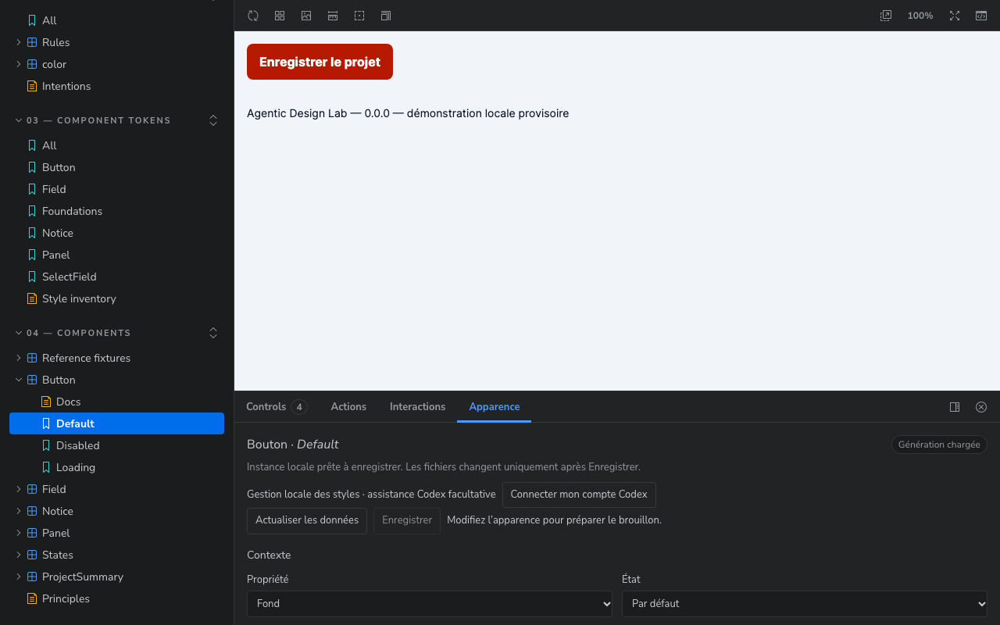
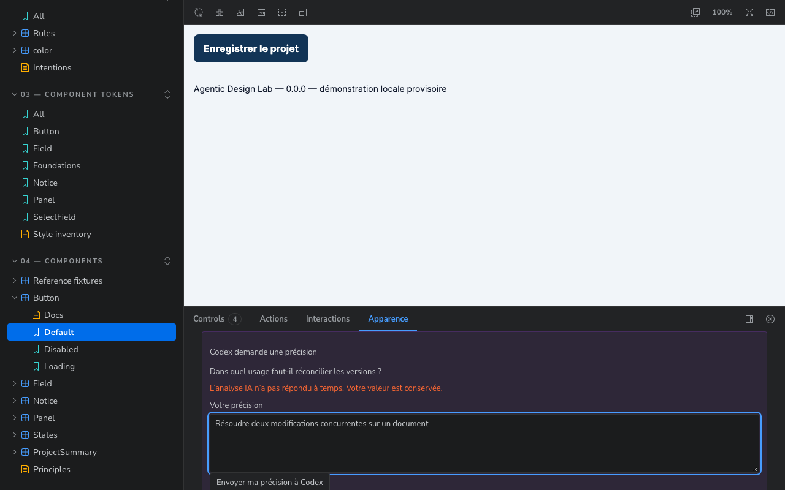
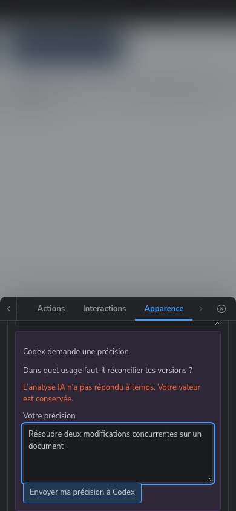

# DS-EDIT-24 — Harmonisation d’Apparence avec Storybook

31 octobre 2026 — cible application. **En revue : qualification technique acquise, acceptation humaine différée.** [Fiche et mandat](../work-items/ds-edit-24-storybook-panel-theme.md), base `b0eb58ec6abcafc5e770bf8bfe7f2ccc9f2b6628`, branche `codex/appearance-storybook-theme`. Les empreintes de [la présentation et du test examinés](ds-edit-24/code.json) identifient la version qualifiée ; aucun changement applicatif après ces vérifications.

## Résultat

Le panneau reprend le thème effectif du manager Storybook via `useTheme` et des variables CSS limitées à sa section. L’import des tokens du produit est retiré du manager ; l’iframe continue de les consommer. Fonds, textes, liens, boutons, cases, champs natifs et zones de texte suivent le thème clair/sombre, avec les retours Codex, erreurs et avertissements. Titres, badge et espacements sont plus compacts ; l’action Enregistrer active possède l’accent du thème. Focus clavier et états désactivés sont conservés.

Les échantillons gardent leurs valeurs exactes, y compris après changement de thème chargé. Aucune source YAML, opération, attribution, autorité, dépendance, route, capacité ou règle de sauvegarde ne change. Les tests de rendu existants reçoivent le même contexte de thème que le manager.

## Contrôles exécutés

macOS arm64 ; runtime Node 24.22.0 déjà présent dans le dépôt, npm 11.19.1 fourni par ce runtime, Storybook 10.6.3 et Chromium verrouillé local. Aucun téléchargement ou réglage global. Les commandes npm utilisent le wrapper livré, avec le runtime compatible dans le PATH du seul processus.

| Contrôle | Résultat |
| --- | --- |
| `npm run typecheck` | Conforme après adaptation du contexte de thème du test de rendu. |
| `npm exec -- vitest run --config config/testing/vitest.config.ts tests/unit/editor-panel-render.test.ts tests/unit/editor-panels.test.ts tests/unit/assisted-session.test.ts` | **15 réussis**, trois fichiers ; portée explicite, panneau et session conservés. |
| ESLint et Prettier sur les trois fichiers de code/test modifiés | Conformes. |
| `npm run build-storybook` | Conforme ; build statique réellement servi et contrôlé. Avertissements hérités de commentaires Zod et taille de bundles conservés. |
| `npm run build` | Conforme, client et SSR ; avertissements hérités Router conservés. |
| [Quatre parcours de développement](ds-edit-24/development.json) | Clair/sombre × 1280×800/390×844 : rendu, champs multiligne, question Codex simulée, erreur simulée, saisie conservée, focus clavier, absence de débordement, échantillons et aperçu exacts. Aucun appel fournisseur réel ou enregistrement. |
| [Quatre parcours statiques](ds-edit-24/static.json) | Mêmes formats/thèmes, brouillon et description conservés pendant les gestes ; interprétation indisponible comme prévu sans service. Aucun enregistrement. |
| Contrastes ciblés | Texte principal 12,75:1 en clair, 9,75:1 en sombre ; texte secondaire 5,91:1 et 5,48:1. Champs et erreur simulée ≥ 4,5:1. Ce contrôle ciblé ne certifie pas l’accessibilité globale. |
| Sources et aperçu de recette | Neuf sources éditables inchangées avant/après les huit parcours. [Modèle et catalogue enregistrés identiques](ds-edit-24/preview-preservation.json) à l’ancienne recette, 188 identités conservées ; aucun état privé copié. |

Les scripts ponctuels de contrôle restent ignorés sous `.local/ds-edit-24/` ; leurs résultats et captures utiles sont sélectionnés ici. Aucune nouvelle suite unitaire de règles CSS. Les tests PostgreSQL, persistance/récupération et inférence réelle ne sont pas répétés : ces chemins ne sont pas modifiés.

### Diagnostics conservés

Les premiers contrôles ont été refusés par le wrapper avec Node système 24.13.1 ; reprise avec le runtime compatible existant. La première implémentation de surface avec `styled` nécessitait un cache Emotion absent du rendu serveur synthétique : remplacée par `useTheme` et une section native, puis types et 15 tests retestés avec succès. Le type du fournisseur de thème exige aussi `children` dans ses propriétés ; corrigé dans la fixture.

Le sandbox refusait le port local et le lancement Chromium ; relances autorisées sans changement de protection. Une première assertion supposait une mise à jour automatique du manager après changement du thème système en session : ce comportement n’existe pas dans le Storybook observé. Les scénarios finaux changent le thème système puis rechargent Storybook **avant toute saisie**, et vérifient la conservation des valeurs enregistrées de l’aperçu. Sur mobile, le tiroir doit être rouvert après ce rechargement ; le scénario a été corrigé puis les huit parcours ont réussi. Aucun maintien d’un brouillon après rechargement n’est promis.

## Revues

Mode **séquentiel, même agent, non indépendant** ; rôles et procédures du catalogue applicatif à la base citée. Aucun sous-agent ni scan distant.

- **Design Reviewer / `review-design` : satisfaisant, acceptation humaine différée.** Lecture de fidélité : les deux thèmes natifs de Storybook sont la référence ; surfaces, typographie et contrôles cohérents avec le manager. Lecture d’expérience : textes, questions/erreurs, champs et focus lisibles aux deux formats ; retours à la ligne sans débordement du panneau. Captures clair/sombre relues. Le défilement du tiroir mobile et le masquage natif de l’aperçu restent des limites existantes. Aucune référence Figma fournie.
- **Technical Reviewer / `technical-review` : satisfaisant.** Diff limité à la surface du panneau, CSS et contexte du test. Variables locales, abonnement au thème fourni par Storybook, import produit retiré du manager, iframe et opérations préservées. Types/tests/builds et huit parcours conformes. Thèmes personnalisés et autres versions de Storybook non qualifiés par cette campagne.
- **Security Reviewer / `security-review` : satisfaisant dans le périmètre local.** Raccordement aux seules valeurs du thème déjà chargé par Storybook ; aucune nouvelle entrée externe, permission, dépendance ou interpolation HTML. Échantillons normalisés et rendu React préexistants conservés ; service, comptes, Host/Origin/capacité et writer inchangés. Navigateur de test isolé et requêtes externes bloquées. Aucun secret, compte ou état privé distribué ; pas d’audit général ni certification.

## Recette et reprise

Nouvel [aperçu local · Apparence](http://127.0.0.1:54127/?path=/story/components-button--default&addonPanel=adl/design-editor/panel), copie isolée `.local/ds-edit-24/preview`. Valeurs enregistrées reprises sous réservation de lecture de la recette 54124, sans journal/reçu, compte ni brouillon. Identité des trois fichiers de code/test vérifiée contre le dépôt ; chargement sans brouillon, service prêt, thème sombre et absence d’erreur navigateur contrôlés. Les anciennes recettes 54124/54123 et leurs services restent préservés. L’assistance de ce nouvel aperçu est déconnectée ; chaque installation garde son compte propre.

Prochaine action : examiner humainement le rendu dans le thème du poste et poursuivre la recette déjà prévue. La direction d’harmonisation est approuvée ; son implémentation reste à accepter. **Doc updated.** Guide du panneau, fiche, roadmap et état de fabrication actualisés. Aucun push, publication, changement des modèles de suivi applicatifs ni clôture G/J5. Risque résiduel : autres navigateurs/OS et thèmes personnalisés non vérifiés ; brouillon volatile existant.
