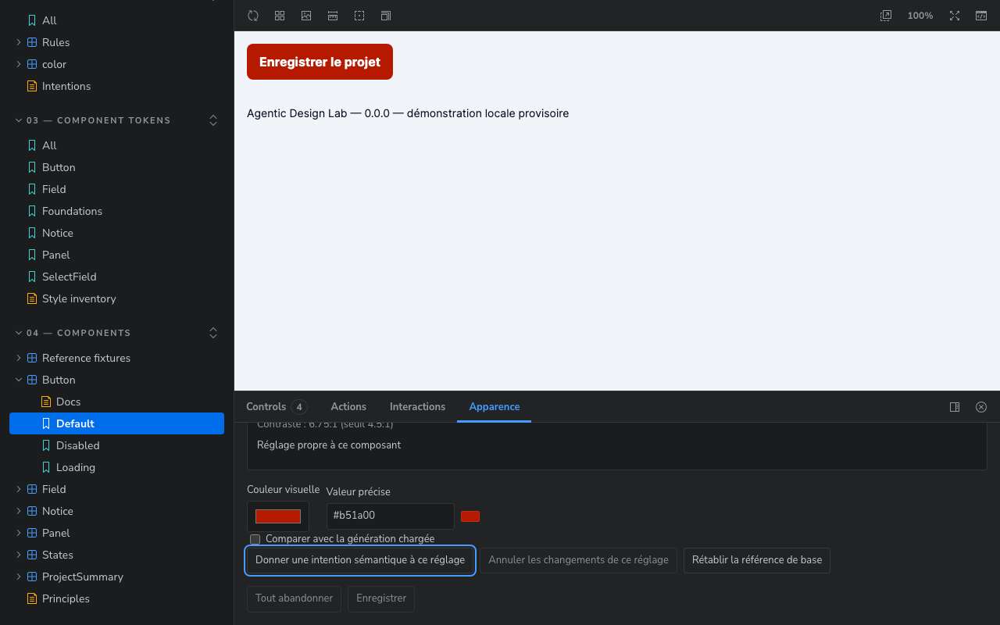
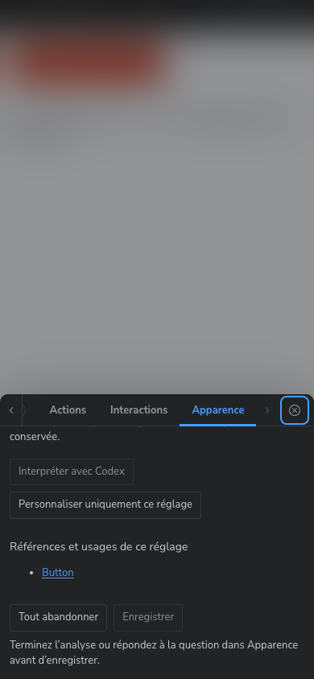

# DS-EDIT-25 — Organisation simplifiée d’Apparence

31 octobre 2026 — cible application. **En revue : qualification technique acquise, acceptation humaine différée.** [Fiche et critères](../work-items/ds-edit-25-appearance-layout.md), base `3c040f65fc62d43f13fe7dcb65cf92ed8c53fe77`, branche `codex/appearance-panel-layout`. Les [empreintes de code](ds-edit-25/qualification.json) identifient les trois fichiers de présentation contrôlés et servis.

## Résultat observable

Le titre prend le nom anglais du composant de sa story préparée, identique à la sidebar, avec le nom de l’exemple en italique. Les informations de service prêt, connexion/quota, succès durable et consigne de brouillon vide sont retirées ; les commandes de connexion restent accessibles. Le titre Contexte, la légende et le contour du réglage disparaissent.

La comparaison se place sous la saisie, hors du groupe désactivé, pour pouvoir quitter ce mode. Les actions de réglage possèdent le même padding qu’Actualiser les données et une disposition flex avec retour à la ligne mobile. Elles précèdent les références : celles-ci apparaissent seulement pendant la définition/interprétation d’une intention, sans accordéon, texte technique ni décompte. Un lien par composant ouvre son exemple préparé ; le retour au réglage d’origine est conservé. Hypothèse de regroupement réversible à examiner lors de la recette humaine.

Enregistrer et Tout abandonner sont en pied de panneau, avec les commandes de vérification/réessai si le résultat est inconnu. Le résumé chiffré des contrastes disparaît ; avertissements, acquittement requis, erreurs, attentes et autres blocages restent visibles. Le succès durable est toujours vérifié par le moteur, puis le badge revient à Génération chargée sans message supplémentaire. Writer, session, sources YAML, données, attributions, dépendances et contrats ne changent pas.

## Contrôles exécutés

macOS arm64, Node 24.22.0 et Chromium local verrouillé. Runtime compatible existant sélectionné dans le PATH du processus avec le wrapper livré ; aucune installation globale. Réseaux externes bloqués dans les parcours ; aucune inférence réelle ni connexion privée transférée.

| Contrôle | Résultat |
| --- | --- |
| `npm run typecheck` | Conforme sur le code final. |
| Vitest ciblé : `editor-panel-render`, `editor-panels`, `assisted-session` | **16 réussis**, trois fichiers ; visibilité conditionnelle, ordre, brouillon et blocage avant réponse couverts. |
| ESLint et Prettier sur les sept fichiers code/CSS/tests affectés | Conformes. |
| `npm run test:design-editor:dev -- --grep 'appearance layout\|shows contextual heading\|does not suggest a pending contrast'` | **6 réussis**, ordinateur/mobile : ordre, titre anglais, suppression des textes, comparaison réversible, liens ouverts et retour, actions et footer. |
| Même sélection avec `npm run test:design-editor` | **6 réussis** ; build statique Storybook conforme, consultation et gestes sans service. |
| `npm run test:design-editor:persistence -- --grep 'component token identity'` | **2 réussis** dans une copie jetable : modifications répétées, sauvegarde depuis le footer, relecture du catalogue, identité et rétablissement. Build client/SSR isolé puis [relecture compilée aux deux formats](ds-edit-25/application-reload.json) conformes. |
| [Quatre parcours de l’aperçu livré](ds-edit-25/qualification.json) | Clair/sombre × 1280×800/390×844 : focus clavier 2 px, comparaison, références conditionnelles, annulation, footer, absence de débordement et d’erreur navigateur. Aucun enregistrement. |
| [Préservation de la recette](ds-edit-25/preview-preservation.json) | Modèle et catalogue identiques à 54127, 188 identités ; couleur enregistrée #b51a00 conservée. Neuf sources éditables identiques avant/après la campagne. Aucun journal, reçu, compte ou brouillon copié. |

[Résultats navigateur sélectionnés](ds-edit-25/browser-tests.json). Les contrôles ponctuels sont conservés sous `.local/ds-edit-25/`, ignoré. Les tests persistants remplacent leur attente de message par le badge de génération effectivement relue, puis vérifient les valeurs dans le catalogue/rechargement. Ni moteur serveur ni format de transaction modifié. Pas de campagne PostgreSQL, récupération exhaustive, autre navigateur/OS ou appel fournisseur ; aucune preuve de recette humaine déduite des tests.

### Diagnostics et limites

Le sandbox a initialement refusé la création de branche et le port loopback ; autorisations ciblées obtenues, sans modification des protections. Le premier contrôle de focus utilisait seulement un focus programmatique après un clic : le navigateur n’appliquait pas `:focus-visible`. Correction du scénario avec une véritable navigation Tab/Shift+Tab ; les quatre retests passent sans modification du CSS. Un premier démarrage d’aperçu a utilisé le Node système par une résolution relative erronée du PATH ; arrêt de ce seul processus puis redémarrage explicite en 24.22.0 avant la campagne finale.

## Revues

Procédures du catalogue applicatif à la base citée ; mode **séquentiel, même agent, non indépendant**, sans délégation.

- **Design Reviewer / review-design : satisfaisant, acceptation humaine différée.** Fidélité : liste des ajustements du designer utilisée comme référence, aucun Figma fourni. Expérience : saisie → comparaison → actions → références conditionnelles → sauvegarde ; absence de contour/légende, liens simples, retour au réglage et focus effectif. Captures ordinateur/mobile clair/sombre relues. Les longues actions reviennent à la ligne sur mobile ; ce comportement évite leur compression. Le défilement du tiroir mobile reste natif.
- **Technical Reviewer / technical-review : satisfaisant.** Diff limité à la présentation, aux attentes UI des tests et à la documentation. Comparaison hors fieldset désactivé ; noms accessibles conservés. Résolution des titres depuis les stories et déduplication des liens sans opération implicite. Raisons bloquantes de sauvegarde et résultats inconnus préservés ; lecture durable exercée réellement dans une copie isolée. Contrôles conformes ; aucune migration nécessaire.
- **Security Reviewer / security-review : satisfaisant dans ce périmètre local.** Aucun nouvel accès, endpoint, compte, permission, dépendance ou HTML injecté. Liens issus des bindings et destinations préparées existants, rendu React conservé. Retrait d’informations sans retrait des contrôles serveur. Sources privées exclues de la nouvelle recette ; pas d’audit global ni certification.

## Accès et reprise

[Aperçu local — Apparence](http://127.0.0.1:54128/?path=/story/components-button--default&addonPanel=adl/design-editor/panel), copie isolée `.local/ds-edit-25/preview`, code contrôlé identique au dépôt. Anciennes recettes, brouillons, reçus et connexions préservés ; la nouvelle copie est déconnectée. Les tests ne déposent aucun brouillon dans cette copie.

Prochaine action : recette visuelle humaine des ajustements, dont le regroupement des liens de composants. **Doc updated.** Guide, fiche et suivi lab synchronisés ; modèles applicatifs et G/J5 inchangés. Aucun push, déploiement ou publication. Risque résiduel : brouillon volatile et plateformes non testées, limites préexistantes.
