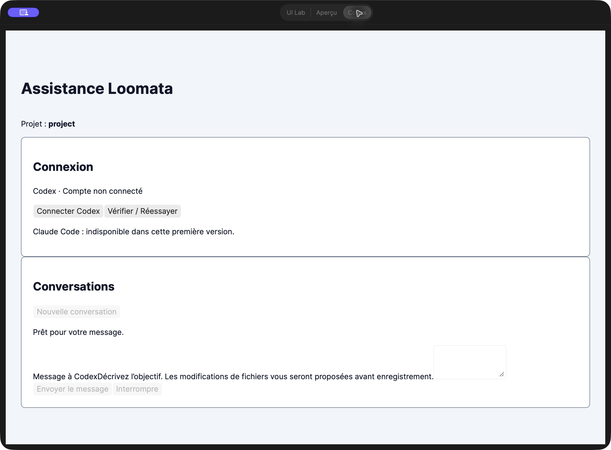

# UI-ARCH-04 — Styles manquants à l'ouverture de Codex

**14 novembre 2026 — En revue, qualification technique acquise, acceptation humaine différée.** [Fiche](../../work-items/ui-arch-04-chat-preparation.md), [preuves structurées](qualification.json). Sources fonctionnelles inchangées à `13d844c` ; réparation de la recette privée `run-Ag62zM`.

## Cause confirmée et correction

L'erreur signalée est reproduite par `buildChatUI` de la copie `tool` : `Could not resolve ../styles/tokens.generated.css`. Son dossier de styles ne contient que les sources global.css/project.css. Le profil de copie exclut légitimement les dérivés ; le helper privé de recette a préparé le projet via prepareProject, mais a omis la génération de l'outillage qui compile et sert la vue Codex. Le packaging courant du produit contient déjà cette génération. Ce défaut de fixture ne justifie ni de modifier l'import ni d'ajouter une régénération automatique au démarrage d'un writer.

Avant correction, la copie d'outillage n'a ni propriétaire DS, ni récupération active, ni reçu, ni verrou de démarrage/daemon chat. Exécution du générateur propriétaire dans **tool uniquement**, sans modification du projet fictif actif :

```sh
node tool/scripts/generate-tokens.mjs
```

Le chemin est relatif au dossier de recette ; le Node employé est le runtime local préparé. Résultat : 24 alias, 53 styles, 188 tokens de composants générés depuis l'autorité propre à l'outillage. Cette autorité est byte-identique à celle du starter canonique, sans valeur recopiée depuis le projet fictif ni CSS écrit à la main.

Le helper ignoré `.local/ui-arch-04/macos-loading/prepare.mjs` génère désormais les dérivés du **nouvel outillage**, après copie de ses dépendances et avant création/préparation du projet. Il n'a pas été relancé sur la recette active. Pour reproduire une nouvelle recette : copier les sources fermées du tool, préparer ses dépendances, lancer son générateur, puis créer/préparer le projet et compiler le bundle distinct. Ne pas confondre les deux racines et ne pas régénérer un projet actif pour réparer les styles de l'outil.

## Contrôles et résultat

| Contrôle exécuté | Résultat |
|---|---|
| Avant génération | Build du chat isolé en échec sur l'import exact fourni par le porteur. |
| Génération tool | Réussie avec Node local ; autorité conservée, dérivés seuls écrits. |
| Après génération | Même build réussi : index HTML de 438 octets, un asset CSS et un JavaScript. |
| Fenêtre normale existante | Message d'erreur fermé, Codex relancé : écran Assistance Loomata chargé, boutons Connecter Codex / Vérifier accessibles, statut compte non connecté. |
| Aller-retour natif | UI Lab retrouvé avec génération et champ de valeur chargés ; seconde ouverture Codex réussie, vue laissée ouverte. Aucun bundle reconstruit ni fenêtre remplacée. |
| Projet fictif | SHA-256 des 312 fichiers contrôlés identiques avant/après ; aucun reçu ajouté. Services 59550/59551 prêts, PID 8556/8775 conservés, aucun redémarrage. |



## Revues, limites et reprise

Revues **séquentielles, même agent, non indépendantes**. Technique/QA : la cause est reproduite puis supprimée par la préparation manquante seule ; aucun changement du build produit ou de la logique chat. Sécurité : aucun compte connecté, inférence, transfert de credentials, permission ou garde modifiée ; aucun verrou/journal purgé. Le daemon local du chat est lancé par le chemin normal d'ouverture et reste disponible pour la recette. Design : présence de l'écran vérifiée, pas de nouvelle qualification graphique comparative ni changement de styles source.

Aucun test métier du chat, build du projet, Storybook ou compilation native supplémentaire n'est annoncé : ces sources ne changent pas. L'envoi de messages et la connexion fournisseur restent non exécutés. La réserve sur la cause du blocage historique de l'UI Lab appartient toujours au [diagnostic antérieur](../ui-arch-04-macos-loading/README.md), distinct de cette absence de dérivé désormais expliquée.

Prochaine action : le porteur peut reprendre sa vérification de **Loomata UI Lab Loading Test**, déjà ouverte sur Codex. Anciennes fenêtres, projet fictif, tokens et 75 préexistants conservés ; Electron exclu, aucune publication. **Doc updated.**
