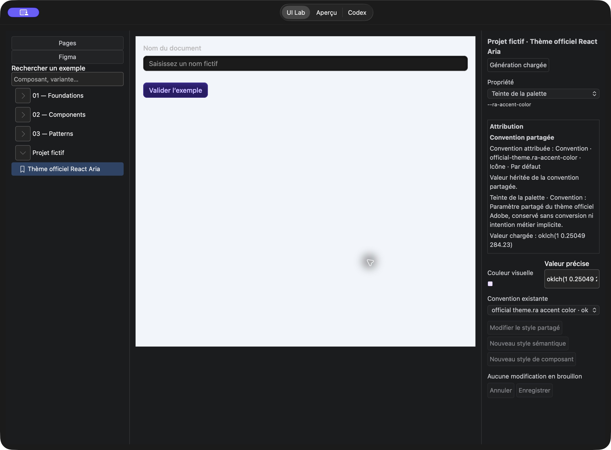

# UI-ARCH-04 — Chargement macOS de l'UI Lab

**14 novembre 2026 — En revue : fonctionnement qualifié dans la nouvelle recette, réserve sur la cause historique ; acceptation humaine différée.** Base `6e065a8`, branche locale `codex/ui-arch-04-macos-loading`. [Fiche et mandat](../../work-items/ui-arch-04-macos-loading.md), [résultats structurés](qualification.json).

## Résultat observable

**Loomata UI Lab Loading Test** ouvre un véritable WKWebView sur un projet fictif isolé. L'arbre, l'aperçu officiel React Aria et la génération éditable sont chargés. Une valeur invalide est refusée ; un brouillon OKLCH valide et sa portée partagée activent Enregistrer. La commande Actualiser présente la confirmation attendue ; Conserver le brouillon maintient sa valeur. Le brouillon de test a ensuite été abandonné explicitement. Un rechargement depuis le serveur aboutit à nouveau au champ éditable et à la valeur initiale `oklch(1 0.25049 284.23)`. Aucun enregistrement n'a été effectué dans cette nouvelle copie.

L'ancienne fenêtre **Loomata UI ARCH 04 Test** n'est ni remplacée ni fermée. Elle a été brièvement consultée puis rendue à sa vue Aperçu initiale ; ses services 51147/51148 sont toujours prêts, avec huit reçus conservés. La seule fenêtre de diagnostic créée pendant cette intervention a été fermée. La fenêtre normale de test et ses services isolés 59550/59551 restent ouverts. Ni Electron, ni publication, ni fournisseur IA, ni installation globale.

## Diagnostic et limites

1. Le document de l'ancienne instance reste sur « Chargement des références… », y compris après Actualiser ordinaire : le client React n'a pas monté l'atelier. Cela n'est pas une absence de tokens et ne prouve pas une panne du serveur, qui répond et fonctionne dans un client indépendant.
2. La réponse SSR destinée au User-Agent WKWebView contient des transferts React utilisant requestAnimationFrame. Ce fait a motivé une hypothèse, pas un diagnostic définitif. La sonde native sans fenêtre, avec animations neutralisées et une seule observation finale, monte pourtant l'atelier sur le même serveur : [mesure](offscreen-no-animation.json). Aucun correctif SSR ni changement de React Router n'est retenu.
3. La fenêtre native instrumentée charge initialement l'atelier. Après les arrêts/reprises de ses seuls services et le retrait de l'instrumentation serveur, elle peut rester sur le document d'attente. Son dernier relevé est `complete`, première animation reçue, un script module, zéro segment caché, aucune exception capturée, champ absent. Cela écarte l'explication simpliste d'un premier frame systématiquement manquant, sans identifier à lui seul le mécanisme interne de WebKit.
4. Le correctif retenu borne les données web de la vue UI Lab à sa durée de vie, ignore le cache local pour ses demandes initiale/Accueil, et utilise `reloadFromOrigin` pour Actualiser. Il ne purge aucun cache existant et ne change pas les autres vues. Les sources et états persistants appartiennent au service local. Le cache périmé reste une **hypothèse** ; aucune expérience contrôlée ne démontre qu'il causait le blocage historique.
5. La nouvelle fenêtre affiche brièvement l'attente après ouverture et rechargement, puis monte l'atelier. Les premières observations d'attente ont été trop précoces pour conclure à un nouvel échec : la qualification repose sur l'état éditable final et les interactions, pas sur un HTTP 200 ni sur le seul lancement du bundle. La présentation explicite de cette fenêtre a précédé son premier état éditable, sans preuve qu'elle était nécessaire.

La réserve est donc précise : la **nouvelle recette fonctionne**, mais la guérison de l'ancien document déjà chargé et l'origine exacte de son blocage ne sont pas qualifiées. Une relance complète supplémentaire du nouveau processus, VoiceOver, Windows/Linux et Electron ne sont pas vérifiés. Aucun message n'affirme une correction causale générale de WebKit.

## Contrôles exécutés

| Contrôle | Résultat et portée |
|---|---|
| Compilation native | `buildLoomata` sur SDK Apple 26.5 installé, Swift 5 ; bundle normal sans sonde ajoutée. Identifiant et nom distincts. |
| Signature locale | `codesign --verify --strict` réussi après retrait ciblé de FinderInfo/ResourceFork du seul nouvel artefact ; quarantaine conservée. Un contrôle intermédiaire avait échoué après réapparition de métadonnées File Provider, échec conservé dans le bilan. Aucune protection désactivée, pas de notarisation publique. |
| Supervision | `node --test tests/local-app.test.mjs` : neuf réussis. Première tentative restreinte : huit refus EPERM sur loopback ; relance autorisée avec accès local, sans changement du code testé. |
| Parcours natif | Accessibilité CUA dans le bundle normal : chargement, validation, portée, protection du brouillon, annulation, rechargement réussi. Une tentative mal ciblée a présenté la confirmation Fermer ; elle a été annulée, aucune fermeture ou sauvegarde de la recette normale. |
| Conservation | SHA-256 identiques pour les 312 fichiers du manifeste fictif et ses entrées App/Storybook/Vite, dont l'autorité DTCG. Aucun CSS, composant, token ou profil de création/export modifié par cette correction. Ancien journal : huit reçus ; copie isolée : zéro. |
| Non-régression web | Pas de nouveau build web, lint web, test de fidélité ou roundtrip sauvegardé : aucune source web modifiée. Les preuves précédentes de 24 images et d'enregistrement Storybook restent celles de leur propre campagne, sans prétendre les avoir rejouées. |
| Relecture | Diff borné au contenant natif et documentation/preuves ; espaces, liens et absence de données de session vérifiés. 75 préexistants non suivis exclus. |

Les commandes, traces de compilation et hash complets restent dans `.local/ui-arch-04/macos-loading/`, ignoré. Les réponses HTML contenant la capacité de session, les états privés et journaux utilisateur ne sont pas publiés. Les seules traces sélectionnées ici sont des compteurs et valeurs fictives.

## Revues et reprise

Même agent dans le même fil, rôles séquentiels, **aucune indépendance**. Design Reviewer : aucun changement visuel prévu ; l'aperçu officiel, l'arbre et les réglages sont visibles, pas de nouvelle recette graphique comparative. Technical Reviewer / QA : modification native limitée, compilation et parcours satisfaits ; réserve causale et relance supplémentaire explicites. Security Reviewer : aucune nouvelle commande JavaScript, origine réseau, capacité d'écriture ou permission ; gardes de navigation et confirmation du brouillon inchangées et cette dernière exercée. Les données web transitoires de l'atelier ne sont pas une sauvegarde ; Figma sessionStorage reste limité à sa session. Revue de distribution non applicable : pas de livraison publique ni changement d'inventaire.

Reprise humaine : ouvrir **Loomata UI Lab Loading Test**, vérifier l'atelier et son thème officiel. Cette recette utilise une nouvelle identité de projet et ne transfère aucun compte ni reçu de l'ancienne. Les bundles privés dépendent du clone et ne constituent pas une distribution autonome. Pour poursuivre une investigation du document historique, conserver ses données et comparer explicitement cache/réseau après démarrage, sans réutiliser un serveur de recette humaine comme fixture destructive. Aucun nouveau chantier n'est ouvert. **Doc updated.**
