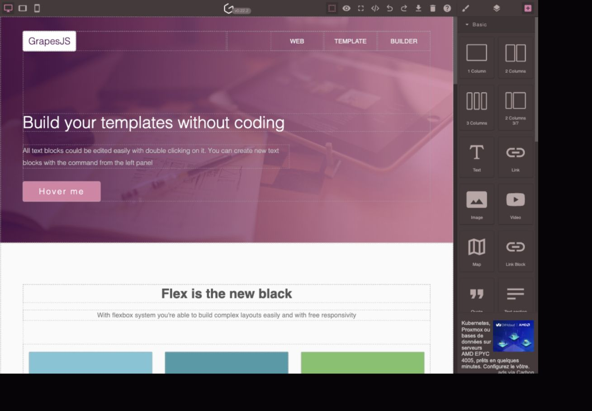
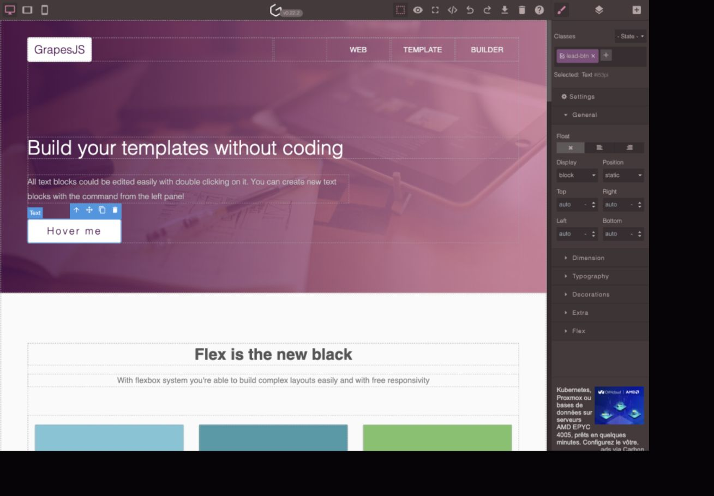
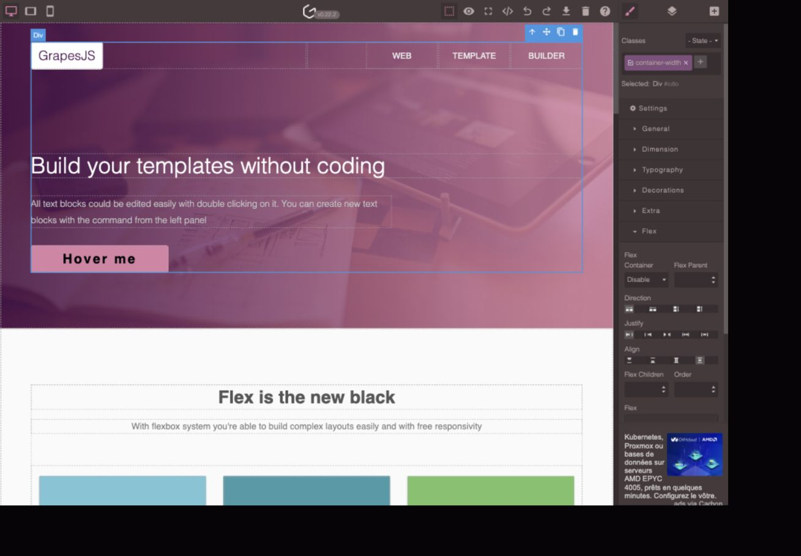
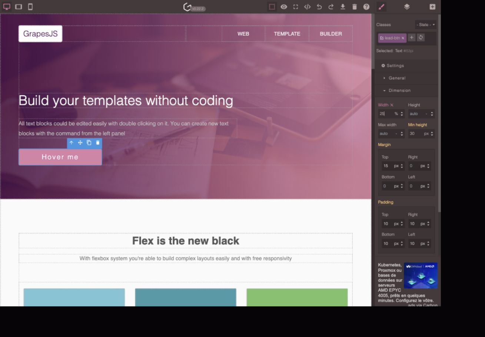
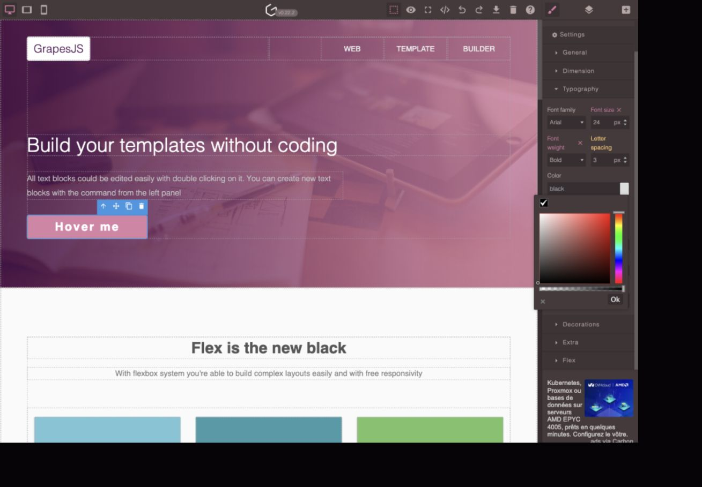
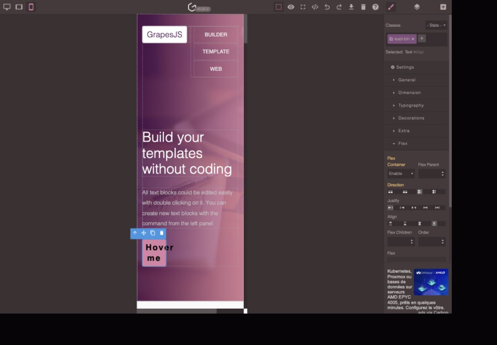

# WYSIWYG-01 — Observation visuelle de GrapesJS

**16 novembre 2026 — En revue, complément d’étude livré ; acceptation humaine différée.** Cible : application. Base `0a518596df6c51a404555b52276239084f596b6f`, branche `codex/wysiwyg-01-grapesjs-ui`. [Étude comparative](../../architecture/visual-inspector-study.md), [architecture proposée](../../architecture/visual-inspector.md), [fiche](../../work-items/wysiwyg-01-visual-inspector.md).

## Périmètre et méthode

Inspection de la [démo officielle GrapesJS](https://grapesjs.com/demo.html), dans le navigateur intégré de Codex, par clics, saisies et lecture de l’état accessible/DOM visible. **Version affichée : v0.22.2**, distincte du manifeste v0.23.9 et du commit de l’étude de code. La démo ne prouve pas le comportement de ce commit ni de toutes les configurations GrapesJS. Aucun accès à un compte, upload, export, publication ou modification de projet Loomata.

Objectif : sélectionner un élément, modifier ses propriétés, comprendre états, unités, retour arrière et navigation parent, puis en tirer des recommandations concrètes. Cible de l’audit : qualité du parcours et risques d’accessibilité, sans certification. Le bouton visuel « Hover me » est un élément Text dans cet exemple : ne pas confondre apparence et sémantique.

Le format initial trop étroit coupait le panneau ; un viewport desktop 1440×1000 a été demandé pour accéder aux contrôles. Les captures effectivement produites par l’outil mesurent **1309×909 pixels** : elles sont conservées telles quelles, sans recadrage ni changement d’échelle manuel. Ce décalage interdit une mesure CSS au pixel à partir des images. Override retiré après l’inspection. Treize JPEG capturés, sauvegardés puis réouverts dans l’outil pour inspection ; seuls les états stabilisés retenus ci-dessous. Un premier état de largeur en cours de rafraîchissement a été remplacé par la capture stabilisée 04.

Skill Product Design audit et procédures applicatives propose-architecture/update-project-docs ; relecture séquentielle, même agent, non indépendante. Préflight user-context retrouvé sous skills/user-context/scripts après un premier chemin absent ; exécuté : aucun contexte sauvegardé. Aucun paramètre global créé. Pas de sous-agent, installation ou serveur local.

## Parcours observé, en sept étapes

### 1. Entrée, sélection et parent — Fonctionnel, identification trop technique pour Loomata

À l’ouverture, catalogue de blocs à droite ; sélectionner « Hover me » ouvre le Style Manager. Contour bleu, label Text et barre locale avec flèche parent/déplacement/copie/suppression. Le panneau affiche classe lead-btn et Text #i53pi. Le clic sur la flèche remonte au conteneur Div #io8o ; le contour couvre alors le grand conteneur et la classe affichée devient container-width. Le clic sur le texte permet de revenir au descendant.

Force : sélection et parent restent liés visuellement au canvas. Risque UX : nom DOM, ID et classe dominent sans expliquer la portée réelle. Risque d’accessibilité : les commandes locales vues dans le DOM sont des div avec SVG, sans nom accessible explicite observé ; aucune conclusion globale de navigation clavier n’en est déduite.

### 2. Dimensions, espacements et unités — Fonctionnel, conversion peu guidée

Dimension déplié puis General replié pour libérer la place. Width initial 190 px, modifié en 260 px avec Entrée : cadre et élément s’élargissent. Menu d’unité ouvert puis % choisi ; valeur saisie 25 et validée : la preview stabilisée montre une largeur relative. Changer l’unité a d’abord conservé le nombre 260, provoquant une expansion transitoire ; aucune conversion équivalente px→% démontrée. Ne pas annoncer une conversion automatique.

Margin et Padding sont regroupés en quatre champs Top/Right/Bottom/Left, chacun avec son unité. Les champs d’espacement ont été inspectés, **pas modifiés**. Force : nombre/unité proches et repérage des quatre côtés. Risque : répétition de huit menus d’unité et panneau dense. Les libellés de valeurs modifiées changent de couleur et une petite croix apparaît ; la couleur seule ne doit pas expliquer provenance et suppression.

### 3. Typographie, rétablissement et Tab — Fonctionnel dans le sous-parcours testé

Typography déplié : police, taille, graisse, espacement des lettres, couleur, interligne, alignements, décoration et ombre. Taille 20→24 px et graisse Normal→Bold : texte agrandi et épaissi dans le canvas. Plus tard, la croix de Font size rétablit le champ à 20 ; le bouton conserve la graisse modifiée. Cela démontre le rétablissement de cette propriété, pas l’annulation de toute la session.

Depuis le champ Font size, Tab place le focus sur son menu d’unité px, confirmé par l’arbre accessible. Cela qualifie seulement ce passage, pas le parcours clavier complet. La croix est exposée comme image ; lui donner un nom et une commande clavier explicites dans Loomata. Le champ Color peut afficher un placeholder black alors que le texte rendu est blanc : le DOM lu confirme qu’il s’agit d’un placeholder, pas d’une valeur saisie. Distinguer valeur réellement lue, défaut indicatif et héritage est essentiel.

### 4. Couleur — Ouverture et saisie fonctionnelles, palette peu explicite

Cliquer dans le champ texte ne déplie pas la palette ; le clic sur l’échantillon l’ouvre. Surface saturation/luminosité, rail de teinte, rail d’opacité apparent, fermeture et bouton Ok. Palette ouverte puis fermée par Ok, sans déplacement de ses rails. Saisie manuelle #123456 dans Color avec Entrée : texte assombri et champ renseigné. Les rails de couleur/opacité n’ont pas été testés ; la capture seule ne les qualifie pas.

Force : aperçu couleur près de sa valeur, édition graphique et textuelle disponibles. Risques : grande palette flottante au-dessus des champs, peu de libellés accessibles exposés dans l’état lu et sens du bouton Ok ambigu sans contexte. Pour Loomata, Ok ferme/valide seulement le geste de couleur, jamais le lot envoyé aux agents.

### 5. Historique — Annulation observée, rétablissement exact non qualifié

Clic sur l’icône de retour arrière de la barre supérieure : texte blanc rétabli et valeur Color vidée. Clic sur l’icône suivante de rétablissement : Color a ensuite affiché black, et non #123456. Le passage à l’état Hover puis retour à l’état normal confirme black dans le panneau. La capture 13 montre cet état final ; la capture 08 montre le retour au blanc.

Il s’agit d’une réserve sur cette séquence de démo, **pas d’un diagnostic de bug dans UndoManager** : une validation initiale de palette et les événements successifs du champ peuvent avoir produit plusieurs opérations, non examinées en interne. Ne pas annoncer un aller-retour exact réussi. Recommandation Loomata : un geste = une entrée d’historique, avec valeur avant/après vérifiable et libellé « Annuler la couleur du texte ».

### 6. État Hover — Contexte inspecté, simulation visuelle non qualifiée

Choix Hover dans le menu State : Selected devient Text #i53pi :hover ; les valeurs de typographie changent, Color affiche #4c114e et plusieurs champs redeviennent vides/indicatifs. Retour à - State - : taille 24, Bold et couleur black réapparaissent. Les valeurs inspectées sont donc contextualisées.

Le texte du canvas ne constitue pas ici une preuve de simulation du pseudo-état. Aucun vrai survol moteur n’a été exercé ; ni enregistrement d’une nouvelle valeur Hover. Le menu et sa répercussion sur les champs sont vérifiés, pas toute la gestion des pseudo-états. Risque : menu discret en haut d’un panneau défilant, changement de contexte facile à manquer.

### 7. Flex et preview étroite — Commandes accessibles par clic, portée responsive à expliciter

Section Flex : Flex Container Disable→Enable puis Direction Column. Segments graphiques pour direction, justification et alignement, champs Grow/Shrink/Basis. Sur l’élément texte choisi, aucun enfant distinct ne permet de démontrer la réorganisation d’une composition ; seules activation et sélection de commande sont observées.

Icône de téléphone : canvas devient étroit et centré, chrome desktop conservé ; texte et bouton se replient. Retour desktop exécuté. Aucune largeur exacte ni règle media créée ou modifiée vérifiée. La preview étroite ne démontre pas à elle seule un breakpoint enregistré.

Force : vocabulaire graphique efficace pour un designer. Risques : symboles seuls et certaines commandes encore affichées sans que leur effet soit pertinent sur la cible. Dans Loomata, distinguer conteneur/élément enfant, préciser un contrôle indisponible, et afficher le breakpoint édité indépendamment de la largeur de preview.

## Recommandations concrètes pour Loomata

Toutes sont des **propositions**, sans acceptation visuelle ni implémentation. Priorité au parcours nominal ; pas de copie du chrome GrapesJS. La [consigne actuelle de sections fixes](../../work-items/ds-ui-06-fixed-inspector.md) reste applicable : aucun accordéon réintroduit. Conserver les formats, tokens, densité et libellés établis, dont Interligne, Bords arrondis et Couleur dans Typographie. Aucune refonte du panneau DS existant par ce rapport.

| Priorité | Proposition pour l’inspecteur Pages | Preuve / critère observable à tester |
| --- | --- | --- |
| P1 | En-tête fixe : nom métier connu, page, composant si démontré et chemin de parents cliquable. À défaut, « Élément non relié ». | Étape 1 : sélectionner parent/enfant sans perdre le contexte ; aucun ID technique inventé ou titre Div seul comme information principale. |
| P1 | Sections fixes nommées Disposition, Dimensions, Espacements, Typographie, Apparence, Responsive et Design system. Défilement indépendant ; contenu non qualifié en consultation avec motif. | Étapes 2/3/7, règle DS-UI-06 : aucun réglage caché derrière un accordéon ; les contrôles pertinents restent trouvables. |
| P1 | Ligne nombre + unité dans un même groupe ; changement d’unité conserve explicitement le nombre sans prétendre convertir. Montrer le résultat calculé en complément lorsque disponible. | Étape 2 : 260 px→260 % ne doit pas surprendre ; état de saisie distinct de la dernière preview valide. |
| P1 | Espacements en groupe Haut/Droite/Bas/Gauche, marge séparée du padding ; commande liée/déliée explicite proposée, avec état annoncé. | Étape 2 : modifier un côté ne change pas les autres ; liaison constitue un geste atomique, et ne change aucune unité implicitement. Commande de liaison non observée dans la démo. |
| P1 | Valeur résolue affichée comme valeur, jamais comme placeholder trompeur ; mention textuelle « héritée », « token connu », « surcharge temporaire » ou « provenance inconnue ». | Étapes 3/6 : le champ ne suggère pas black quand le rendu observé est blanc sans explication. La couleur du label ne suffit pas. |
| P1 | Couleur : échantillon en aplat + valeur textuelle ; popover avec nom, focus, Échap/fermeture et retour au champ. Rail d’opacité accompagné d’une valeur numérique. | Étape 4 : couleur éditable au clavier, sans palette flottante qui masque durablement le contexte ; fermeture sans envoi agentique. |
| P1 | Actions nommées : « Rétablir cette propriété », « Annuler », « Rétablir », « Réinitialiser les retouches ». Indiquer le nombre de modifications. | Étapes 3/5 : retour exact avant/après, libellé accessible, pas de petite croix sans explication ni couleur seule. |
| P1 | Pied fixe : « Aperçu local · N retouches », action principale « Transmettre à Loomata », secondaire de réinitialisation. Récapitulatif avant/après et portée avant l’envoi. | Étapes 4/5 : séparer validation d’un contrôle, lot reçu et application définitive ; ne pas importer le comportement de sauvegarde directe de la démo. |
| P1 | Dans Pages seulement : « Cet élément / Ce composant / Design system » comme intention de demande, impacts connus et avertissement « Aperçu limité à l’élément sélectionné ». | Étapes 1/6 : ne pas exposer un éditeur de classes comme sélecteur de portée ; 038 demeure inchangée dans Foundations/Components. |
| P2 | Contrôles Flex visuels avec noms accessibles, état sélectionné et distinction conteneur/enfant ; masquer seulement les capacités hors contexte justifiées, sans supprimer les valeurs consultables. | Étape 7 : Row/Column nommés ; contrôle sans effet annoncé comme tel ; vérifier avec un vrai conteneur multi-enfants avant qualification. |
| P2 | Bande de contexte visible : état + breakpoint connu ; commandes de largeur de preview séparées. Ne pas confondre « fenêtre étroite » et « règle responsive ». | Étapes 6/7 : changement de contexte annoncé, reprise du focus et lot associé à la bonne condition ; aucune nouvelle exigence mobile pour Loomata. |

Composition recommandée : en-tête de cible et contexte, sections fixes avec lignes de réglage, pied de lot, puis chat dans son espace existant. Les contrôles permanents de l’inspecteur s’appuient sur React Aria/tokens outil ; les conventions GrapesJS guident leur fonctionnement, sans importer son Style Manager ni ses couleurs.

## Limites et conclusion de revue

Pas d’audit de toutes les fonctions GrapesJS : édition de texte par double clic, drag/drop, couches, classes partagées, publication, sauvegarde, Grid, décoration/ombres, mutation effective des espacements et rails de couleur non testés. Pas de saisie invalide, mesure de contraste, lecteur d’écran, zoom navigateur, Firefox ou WKWebView ; aucune conformité WCAG revendiquée. Un seul parcours de démo et une seule session desktop. La preview étroite n’est pas une campagne responsive exhaustive. Aucun comportement de la v0.23.9 qualifié par ces captures.

Revue design documentaire : satisfaisante avec réserves de l’étape 5 et limites explicites ; les observations ont été distinguées des recommandations. Revue technique de raccordement : cohérence avec l’architecture WYSIWYG-01 et les sections fixes vérifiée, pas de revue d’implémentation. Revue sécurité d’une nouvelle capacité non applicable : aucun accès ou code ajouté ; aucune donnée privée envoyée au site. Toutes ces relectures sont séquentielles, même agent, non indépendantes.

**Doc updated.** Contrôles documentaires exécutés : 48 liens locaux de la fiche, des deux notes et du rapport résolus ; treize images JPEG présentes et affichées pour inspection, 1 033 215 octets au total ; dimension 1309×909 lue sur la capture 03 par sips. git diff --check conforme ; diff relu, six documents et treize images exclusivement sélectionnés. Les 86 chemins non suivis préexistants restent présents hors sélection ; aucune donnée privée ajoutée. Les erreurs exploratoires de préflight et d’inspection via Pillow absent n’ont entraîné aucune installation : préflight retrouvé et exécuté ; dimensions lues par sips. Aucun test/build Loomata lancé. Prochaine action : examiner ces propositions, puis les traduire en critères UI dans le mandat C/D ; aucune adoption d’accordéons ni modification du produit par cet audit. Configuration recommandée : GPT-6.1 Sol · Élevée pour l’intégration WYSIWYG-01, sans hausse nouvelle justifiée par cette observation.
